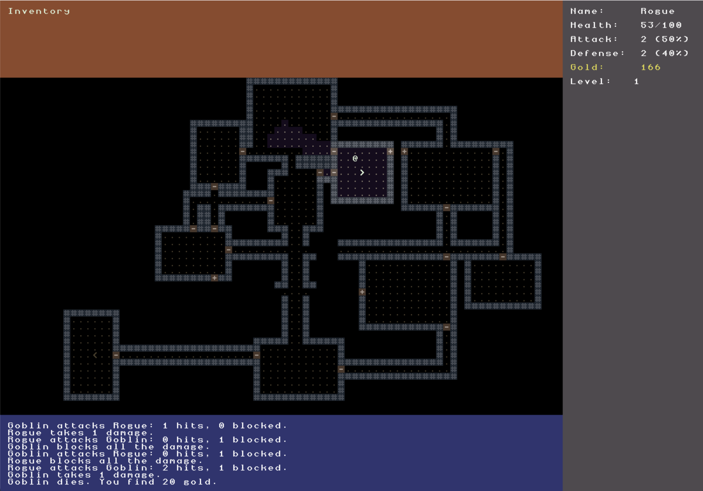

# DungeonHero

A turn-based roguelike written in modern C# (.NET 10). Explore procedurally generated dungeons, fight goblins and descend as deep as you can.



The long-term goal is an online leaderboard with a daily challenge, where everyone plays the same seeded dungeon and runs are verified on the server.

## Features

- **Procedural dungeons:** rooms connected by corridors, doors at room entrances, stairs leading to the next level
- **Field of view:** you only see what your character sees, explored areas stay on the map
- **Turn-based scheduling:** actors act according to their speed via a priority queue
- **Monster AI:** goblins notice you, hunt you down using pathfinding and give up after a while
- **Combat:** dice-based attack and defense rolls, gold drops, game over on death
- **Scaling difficulty:** goblins get stronger on deeper levels
- **Seedable randomness:** every run is reproducible from its seed (shown in the window title)

## Controls

| Key | Action |
|---|---|
| Arrow keys | Move / attack by moving into a monster |
| `.` | Take the stairs down |
| `Esc` | Quit |

## Getting started

Requires the [.NET 10 SDK](https://dotnet.microsoft.com/download).

```
git clone https://github.com/LinusDeez/DungeonHero.git
cd DungeonHero
dotnet run --project DungeonHero.Client
```

Run the tests:

```
dotnet test
```

## Architecture

```
DungeonHero.sln
├── DungeonHero.Core/        Game logic (map generation, combat, AI, scheduling)
├── DungeonHero.Client/      Rendering and input with SadConsole
└── DungeonHero.Core.Tests/  xUnit tests for the game logic
```

- **Core has no UI dependency.** It only references RogueSharp. The client reads the game state and draws it, so the logic can later be reused on a server to verify runs.
- **No global state.** A `GameState` object holds the map, the player, the schedule and the message log. Dependencies are passed in via constructors, `Program.cs` is the composition root.
- **Deterministic randomness.** All random rolls go through an injected, seeded `IRandom`. This makes tests stable and enables a shared daily seed.

## Tech stack

- [RogueSharp](https://github.com/FaronBracy/RogueSharp) for map, field of view and pathfinding
- [SadConsole](https://github.com/Thraka/SadConsole) on MonoGame for the window, rendering and input
- xUnit for tests

## Roadmap

- [x] Dungeon generation, field of view, combat, monster AI, multiple levels
- [ ] Items and inventory
- [ ] CI with GitHub Actions (build and test on every push)
- [ ] ASP.NET Core API with EF Core for an online leaderboard (score, depth, cause of death)
- [ ] Daily challenge with server-side run verification, Docker setup

## Credits

- Font: Cheepicus 12×12, as bundled with the SadConsole repository

## License

[MIT](LICENSE)
